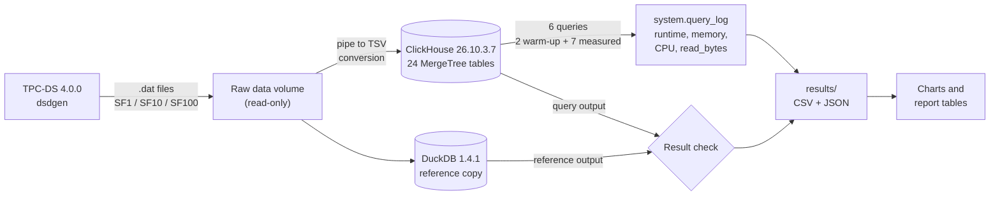
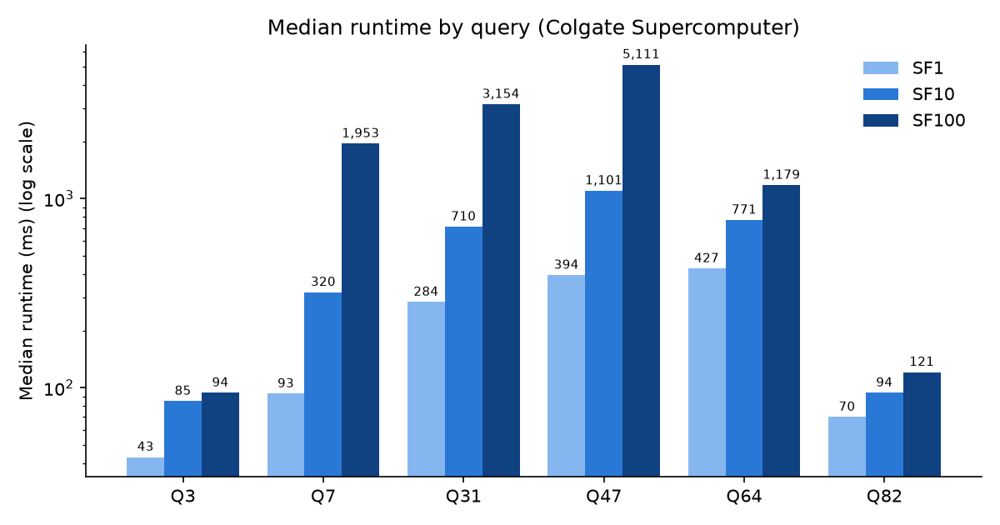
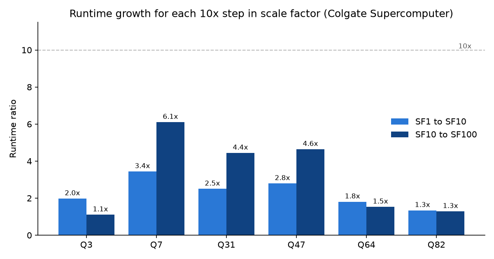

<div align="center">
  <h1>TPC-DS Benchmarking on ClickHouse</h1>
  <p>CAS4121 Big Data, Team 12</p>
</div>

This project runs a TPC-DS workload on ClickHouse and measures how query performance changes with data size.
The workload is six TPC-DS queries (Q3, Q7, Q31, Q47, Q64, Q82) on one ClickHouse node.
Milestone 3 measures runtime, query memory, CPU time, and logical reads at scale factors 1, 10, and 100.
The results in the Milestone 3 report were measured on the Colgate University Supercomputer.

These are measurements of selected queries. They are not official TPC-DS benchmark scores.

## System Design



- **Data generation:** the TPC-DS 4.0.0 `dsdgen` builds the 24 tables at each scale factor.
- **Loading:** a Python loader converts the pipe-separated files to TSV and streams them into ClickHouse. ClickHouse runs in Docker on the laptop, and in Singularity on the supercomputer. Row counts are checked for all 24 tables, and the file hashes are recorded. The SF1 and SF10 files have the same hashes on the laptop and the supercomputer.
- **Validation:** at SF10 and SF100, DuckDB loads the same raw files, and the six query outputs from ClickHouse must match the DuckDB reference before timing starts. The SF1 outputs are compared with the results saved in the earlier milestones.
- **Measurement:** each query runs 2 warm-up rounds and 7 measured rounds in a seeded random order. Metrics come from ClickHouse's `system.query_log`.

## Repository Structure

```text
tpcds-project/
├── tpc-ds/                      workload: schema, queries, SF1 scripts, result figures
│   ├── codes/
│   ├── figures/
│   ├── queries/
│   ├── schema/
│   └── readme.md
└── milestone3/                  controlled SF1 / SF10 / SF100 experiment
    ├── results-hpc-nolimit/     SF1 / SF10 / SF100 on the supercomputer, no limits (used in the report)
    ├── results-hpc/             SF1 / SF10 / SF100 on the supercomputer, 4 threads and 6 GiB per query
    ├── results/                 SF1 / SF10 on a laptop, with validation evidence
    ├── hpc/                     scripts and notes for the supercomputer runs
    ├── RESULTS.md               write-up of the laptop results
    └── README.md                how to run the experiment
```

## Getting Started

### Requirements

- Docker Desktop with Linux containers
- Python 3.11 or newer
- The official [TPC-DS 4.0.0 toolkit](https://www.tpc.org/tpc_documents_current_versions/current_specifications5.asp). The toolkit and generated data are not in this repository.

### Run the scalability experiment

```sh
cd milestone3
python manage.py build-toolkit --source-dir "/path/to/DSGen-software-code-4.0.0"
docker build -t team12-tpcds-validation:1.4.1 -f validation/Dockerfile .
```

Then follow [milestone3/README.md](milestone3/README.md) to generate, load, validate, and measure each scale factor.
[milestone3/DESKTOP_SF100.md](milestone3/DESKTOP_SF100.md) runs all three scales in one loop.
[milestone3/hpc/README.md](milestone3/hpc/README.md) describes the supercomputer runs, which use Slurm and Singularity.

### Plot the results

```sh
cd tpc-ds
uv run --with matplotlib python codes/plot_results.py
uv run --with matplotlib python codes/plot_results.py --summary ../milestone3/results-hpc-nolimit/scaling_summary.csv \
  --output figures/hpc-nolimit --note " (Colgate Supercomputer)"
```

The first command draws the laptop charts. The second draws the supercomputer charts.

### SF1 setup from Milestone 2

The original single-scale setup (Docker Compose, schema, importer, simple benchmark runner) is in [tpc-ds/readme.md](tpc-ds/readme.md#4-sf1-setup-milestone-2-workflow).

## Results

### SF1, SF10 and SF100 on the Colgate University Supercomputer

These are the results in the Milestone 3 report. They come from one node (n16) with two Intel Xeon Gold 6138 CPUs.
The job had 32 cores and 200 GiB of memory. ClickHouse had no container limits, and the queries had no thread, memory, or time limit.
The database files were in RAM.

All 126 measured runs succeeded. All six outputs matched DuckDB at SF10 and SF100, and the SF1 outputs matched the saved results.

| Scale factor | Raw files (GB) | Rows in 24 tables | ClickHouse storage (GB) |
|---|---:|---:|---:|
| SF1 | 1.25 | 19,557,375 | 0.61 |
| SF10 | 12.20 | 191,496,658 | 4.08 |
| SF100 | 103.42 | 959,037,925 | 36.86 |

<div align="center">
  
</div>

| Query | SF1 median (ms) | SF10 median (ms) | SF100 median (ms) | SF10 / SF1 | SF100 / SF10 |
|---|---:|---:|---:|---:|---:|
| Q3 | 43 | 85 | 94 | 1.98x | 1.11x |
| Q7 | 93 | 320 | 1,953 | 3.44x | 6.10x |
| Q31 | 284 | 710 | 3,154 | 2.50x | 4.44x |
| Q47 | 394 | 1,101 | 5,111 | 2.79x | 4.64x |
| Q64 | 427 | 771 | 1,179 | 1.81x | 1.53x |
| Q82 | 70 | 94 | 121 | 1.34x | 1.29x |

<div align="center">
  
</div>

The measurements are in [milestone3/results-hpc-nolimit](milestone3/results-hpc-nolimit).
[milestone3/results-hpc](milestone3/results-hpc) is an earlier set from the same node with 4 threads, 6 GiB, and 300 seconds per query.
The setup and the differences from the laptop run are in [milestone3/hpc/README.md](milestone3/hpc/README.md).

### SF1 and SF10 on a laptop

This run used an AMD Ryzen 9 6900HS laptop, with 4 CPUs and 8 GiB given to ClickHouse and 4 threads and 6 GiB per query.
All 84 measured runs succeeded, and all six SF10 outputs matched DuckDB. Full tables are in [milestone3/RESULTS.md](milestone3/RESULTS.md).
The laptop and supercomputer runs used different hardware and limits, so their numbers should not be combined.

| Query | SF1 median (ms) | SF10 median (ms) | SF10 / SF1 |
|---|---:|---:|---:|
| Q3 | 18 | 83 | 4.61x |
| Q7 | 95 | 931 | 9.80x |
| Q31 | 175 | 1,371 | 7.83x |
| Q47 | 525 | 3,751 | 7.14x |
| Q64 | 221 | 728 | 3.29x |
| Q82 | 22 | 46 | 2.09x |

More charts from both runs (memory, CPU time, logical reads) are in [tpc-ds/readme.md](tpc-ds/readme.md#3-results).

## Team

Junhyuk Her, Nur Farah Husna binti Junaidi, Donggeun Yu, Anthony Bolivar, Reed Gilbert

## References

- [TPC-DS specification and tools](https://www.tpc.org/tpcds/)
- [ClickHouse TPC-DS query collection](https://github.com/ClickHouse/ClickHouse/tree/master/tests/benchmarks/tpc-ds/queries)
- [ClickHouse documentation](https://clickhouse.com/docs)
- [DuckDB](https://duckdb.org/)
