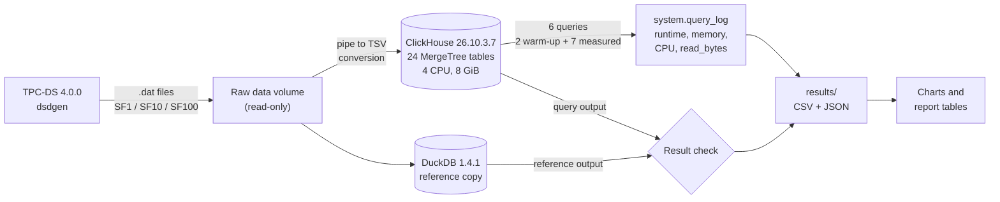
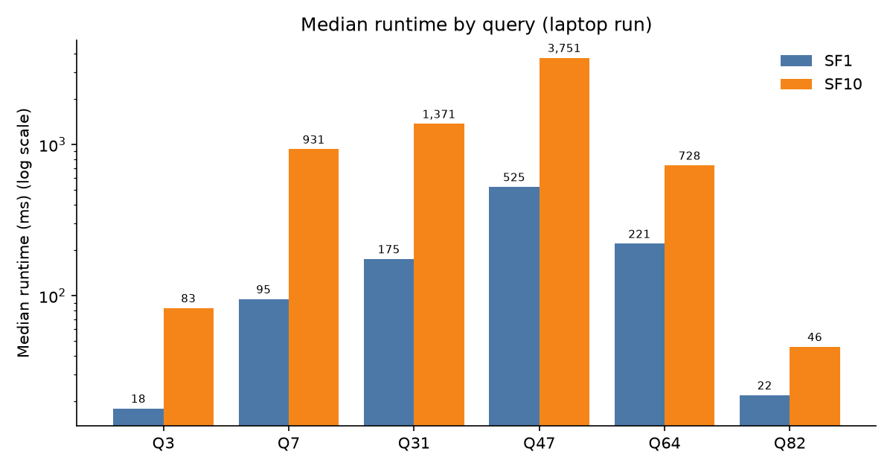
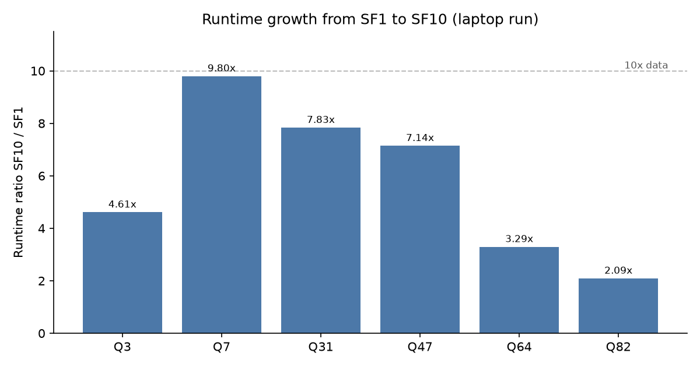

<div align="center">
  <h1>TPC-DS Benchmarking on ClickHouse</h1>
  <p>CAS4121 Big Data, Team 12</p>
</div>

This project runs a TPC-DS workload on ClickHouse and measures how query performance changes with data size.
The workload is six TPC-DS queries (Q3, Q7, Q31, Q47, Q64, Q82) on one ClickHouse node in Docker.
Milestone 3 measures runtime, query memory, CPU time, and logical reads at scale factors 1, 10, and 100.

These are measurements of selected queries. They are not official TPC-DS benchmark scores.

## System Design



- **Data generation:** the official TPC-DS 4.0.0 `dsdgen` builds the 24 tables at each scale factor.
- **Loading:** a Python loader converts the pipe-separated files to TSV and streams them into ClickHouse inside Docker. Row counts and file hashes are checked for all 24 tables.
- **Validation:** DuckDB loads the same raw files. The six query outputs from ClickHouse must match the DuckDB reference before timing starts.
- **Measurement:** each query runs 2 warm-up rounds and 7 measured rounds in a seeded random order. Metrics come from ClickHouse's `system.query_log`.

## Repository Structure

```text
tpcds-project/
├── tpc-ds/              workload: schema, queries, SF1 scripts, result figures
│   ├── codes/
│   ├── figures/
│   ├── queries/
│   ├── schema/
│   └── readme.md
└── milestone3/          controlled SF1 / SF10 / SF100 experiment
    ├── results/         recorded measurements and validation evidence
    ├── RESULTS.md       results write-up
    └── README.md        how to run the experiment
```

## Getting Started

### Requirements

- Docker Desktop with Linux containers
- Python 3.11 or newer
- The official [TPC-DS 4.0.0 toolkit](https://www.tpc.org/tpc_documents_current_versions/current_specifications5.asp). The toolkit and generated data are not in this repository.

### Run the scalability experiment

```sh
cd milestone3
python manage.py build-toolkit --source-dir "/path/to/DSGen-software-code-4.0.0"
docker build -t team12-tpcds-validation:1.4.1 -f validation/Dockerfile .
```

Then follow [milestone3/README.md](milestone3/README.md) to generate, load, validate, and measure each scale factor.
[milestone3/DESKTOP_SF100.md](milestone3/DESKTOP_SF100.md) runs all three scales in one loop.

### Plot the results

```sh
cd tpc-ds
uv run --with matplotlib python codes/plot_results.py
```

### SF1 setup from Milestone 2

The original single-scale setup (Docker Compose, schema, importer, simple benchmark runner) is in [tpc-ds/readme.md](tpc-ds/readme.md#4-sf1-setup-milestone-2-workflow).

## Results

The current figures come from the SF1 and SF10 laptop run (AMD Ryzen 9 6900HS, 4 CPUs and 8 GiB given to ClickHouse).
All 84 measured runs succeeded, and all six SF10 outputs matched DuckDB. Full tables are in [milestone3/RESULTS.md](milestone3/RESULTS.md).

<div align="center">
  
</div>

| Query | SF1 median (ms) | SF10 median (ms) | SF10 / SF1 |
|---|---:|---:|---:|
| Q3 | 18 | 83 | 4.61x |
| Q7 | 95 | 931 | 9.80x |
| Q31 | 175 | 1,371 | 7.83x |
| Q47 | 525 | 3,751 | 7.14x |
| Q64 | 221 | 728 | 3.29x |
| Q82 | 22 | 46 | 2.09x |

<div align="center">
  
</div>

More charts (memory, CPU time, logical reads) are in [tpc-ds/readme.md](tpc-ds/readme.md#3-results).

## Team

Junhyuk Her, Nur Farah Husna binti Junaidi, Donggeun Yu, Anthony Bolivar, Reed Gilbert

## References

- [TPC-DS specification and tools](https://www.tpc.org/tpcds/)
- [ClickHouse TPC-DS query collection](https://github.com/ClickHouse/ClickHouse/tree/master/tests/benchmarks/tpc-ds/queries)
- [ClickHouse documentation](https://clickhouse.com/docs)
- [DuckDB](https://duckdb.org/)
