# TPC-DS on ClickHouse

This folder holds the workload: the schema, the six selected queries, the SF1 setup scripts, and the result figures.
The controlled Milestone 3 experiment (SF1, SF10, SF100) lives in [`../milestone3`](../milestone3/README.md).

```text
tpc-ds/
├── codes/          setup, import, benchmark and plotting scripts
├── figures/        result charts
├── queries/        the six selected TPC-DS queries (ClickHouse SQL)
├── schema/         ClickHouse DDL for the 24 TPC-DS tables
└── docker-compose.yml
```

## 1. Database and Schema

TPC-DS models a retailer that sells through stores, a catalog, and the web.
It has 24 tables: 7 fact tables and 17 dimension tables in a multi-snowflake schema.
All tables use the ClickHouse `MergeTree` engine. The DDL is in [`schema/create_tables_nullable.sql`](schema/create_tables_nullable.sql).

The diagram shows the tables that the six selected queries read.
`store_sales` is the center of the workload: every query reads it.

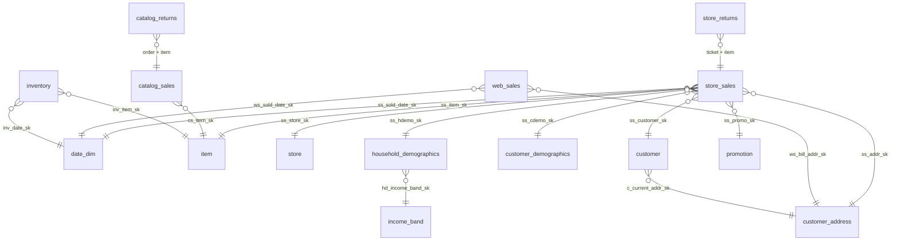

## 2. Queries

The workload uses six of the 99 TPC-DS queries. They were chosen in Milestone 1 to cover different query classes.
The SQL comes from the [ClickHouse TPC-DS query collection](https://github.com/ClickHouse/ClickHouse/tree/master/tests/benchmarks/tpc-ds/queries).

| Query | File | Tables read | Main operations |
|---|---|---|---|
| Q3 | [`query_03.sql`](queries/query_03.sql) | store_sales, date_dim, item | Star join, group by, order by |
| Q7 | [`query_07.sql`](queries/query_07.sql) | store_sales, date_dim, item, customer_demographics, promotion | Star join with dimension filters, averages |
| Q31 | [`query_31.sql`](queries/query_31.sql) | store_sales, web_sales, date_dim, customer_address | Two CTEs, cross-channel quarterly growth ratios |
| Q47 | [`query_47.sql`](queries/query_47.sql) | store_sales, date_dim, item, store | Window functions (`avg`, `rank`), self join on the CTE |
| Q64 | [`query_64.sql`](queries/query_64.sql) | 13 tables, incl. store/catalog sales and returns | Largest join graph, CTE joined to itself across years |
| Q82 | [`query_82.sql`](queries/query_82.sql) | item, inventory, date_dim, store_sales | Range filters, inventory join, group by |

## 3. Results

Charts are made by [`codes/plot_results.py`](codes/plot_results.py) from a `scaling_summary.csv` file.
Each bar is the median of seven measured runs. The script plots every scale factor it finds in the file.

| Charts | Summary file | Run |
|---|---|---|
| [`figures/hpc-nolimit`](figures/hpc-nolimit) | `milestone3/results-hpc-nolimit` | Colgate University Supercomputer, no limits (used in the report) |
| [`figures/hpc`](figures/hpc) | `milestone3/results-hpc` | Colgate University Supercomputer, 4 threads, 6 GiB and 300 s per query |
| [`figures`](figures) | `milestone3/results` | Laptop, SF1 and SF10, 4 CPUs and 8 GiB |

```text
uv run --with matplotlib python codes/plot_results.py --summary ../milestone3/results-hpc-nolimit/scaling_summary.csv --output figures/hpc-nolimit --note " (Colgate Supercomputer)"
uv run --with matplotlib python codes/plot_results.py --note " (laptop run)"
```

### 3.1 Colgate University Supercomputer (SF1, SF10, SF100)

<div align="center">
  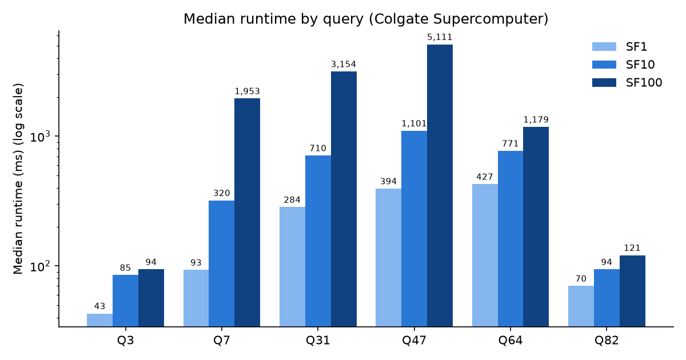
</div>

<div align="center">
  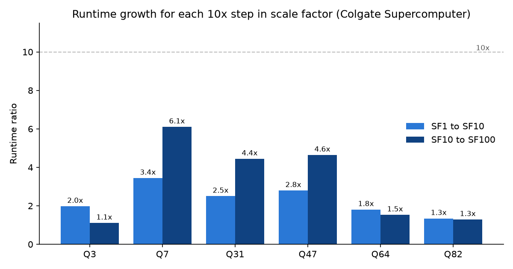
</div>

| Memory | CPU time | Logical reads |
|---|---|---|
| 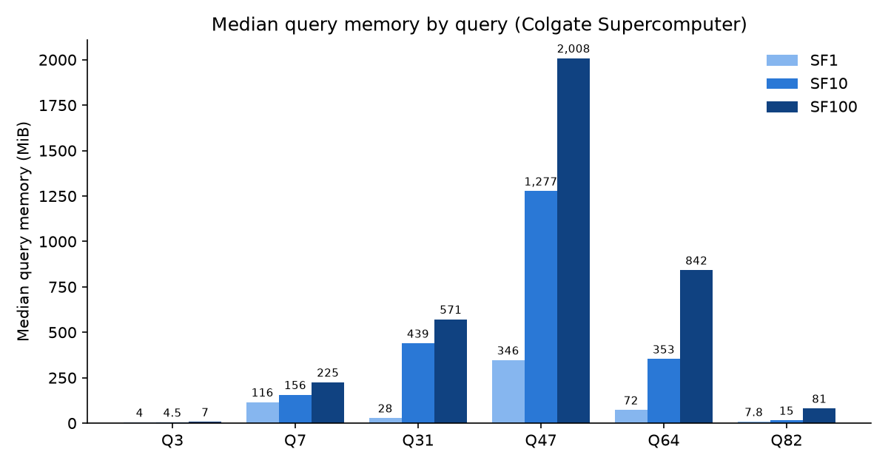 | 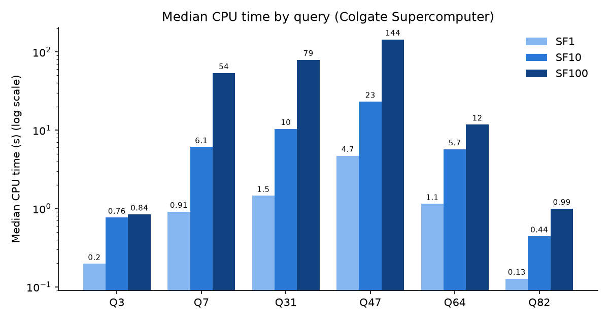 | 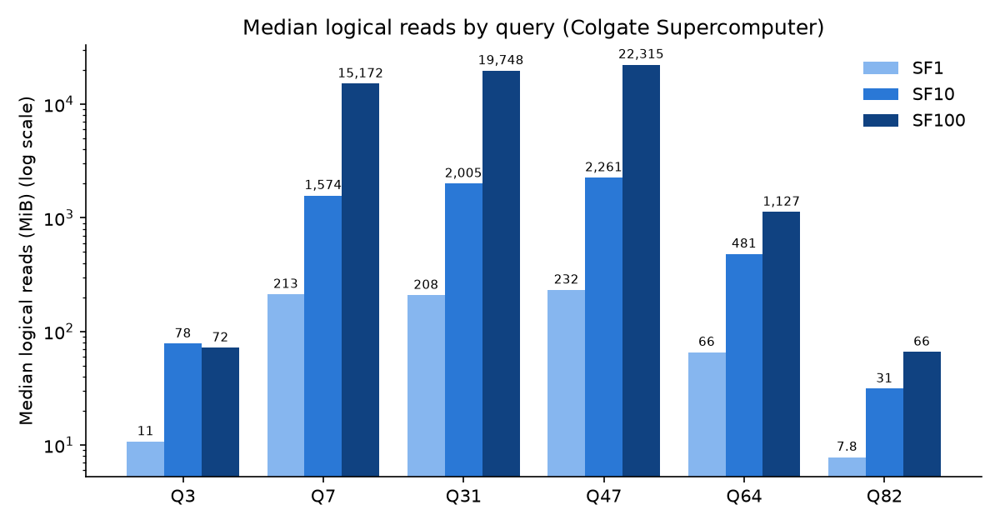 |

Setup notes are in [`../milestone3/hpc/README.md`](../milestone3/hpc/README.md).

### 3.2 Laptop (SF1, SF10)

<div align="center">
  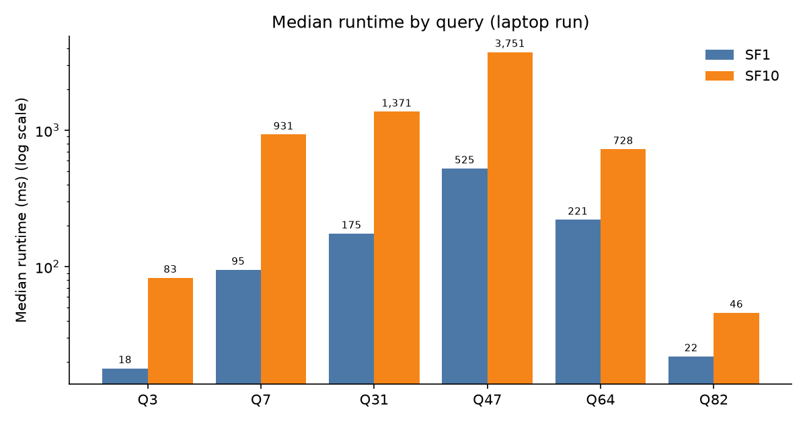
</div>

<div align="center">
  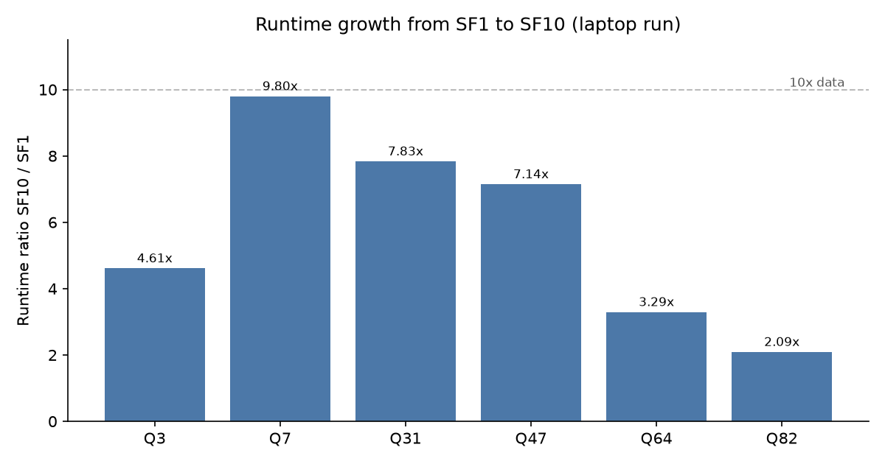
</div>

| Memory | CPU time | Logical reads |
|---|---|---|
| 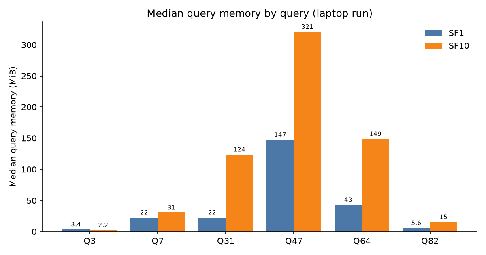 | 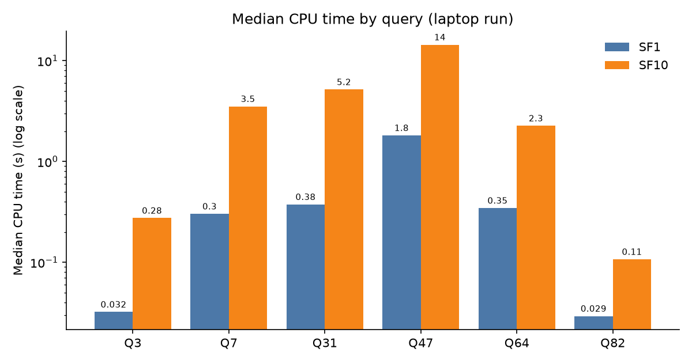 | 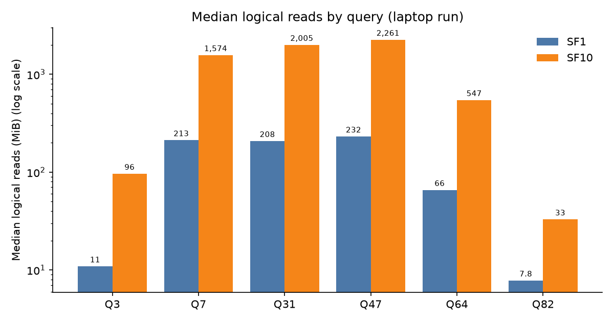 |

Full tables are in [`../milestone3/RESULTS.md`](../milestone3/RESULTS.md).

## 4. SF1 Setup (Milestone 2 workflow)

Run every command in this section from the `tpc-ds` folder.
The Milestone 3 experiment uses its own scripts in `../milestone3` and does not need these steps.

### 4.1 Prerequisites

The following tools are required:

- Windows with PowerShell
- Docker Desktop with Linux containers enabled
- Python 3.12 or a compatible Python 3 version
- Git
- TPC-DS 4.0.0 data-generation toolkit

Docker Desktop must be running before starting ClickHouse.

### 4.2 Start ClickHouse

From the project root directory, run:

```powershell
docker compose up -d
```

Verify that the container is running:

```powershell
docker ps
```

The configured container name is:

```text
tpcds-clickhouse
```

The Docker Compose configuration uses the ClickHouse image version `26.10.3.7` and a persistent Docker volume.

**Important:** The Docker Compose setup is intended for a fresh environment. Do not run it to replace an existing ClickHouse container without checking the container and volume names.


### 4.3 Initialize the Database

After starting ClickHouse, initialize the database from the `tpc-ds` folder:

```powershell
.\codes\init_database.ps1
```

The initialization script is intended to:

1. Create the `tpcds_test` database if it does not exist.
2. Execute the SQL schema.
3. Create the 24 TPC-DS tables.

The schema uses ClickHouse MergeTree tables.

The `date_dim.d_date` column uses `Date32` to support historical dates before 1970.

**Important:** The initialization script has passed a PowerShell syntax check. It has not been run from start to finish on a clean installation.

The existing populated local database should not be deleted or replaced for setup testing.

### 4.4 Generate the TPC-DS Dataset

The project uses TPC-DS version 4.0.0 with Scale Factor 1 (SF1).

The generated dataset consists of data files for 24 TPC-DS tables.

To prepare the dataset:

1. Obtain the TPC-DS 4.0.0 data-generation toolkit from an authorized source.
2. Build the toolkit's `dsdgen` utility.
3. Generate TPC-DS SF1 data.
4. Place the generated `.dat` files inside the project's `data/` directory.

Expected location:

```text
data/
├── customer.dat
├── date_dim.dat
├── store_sales.dat
├── ...
└── (other generated TPC-DS table files)
```

The `dbgen_version.dat` metadata file is not imported as a database table.

The toolkit source code and generated data files are not included in this GitHub repository.

**Note:** Toolkit build and data generation commands are in [`../milestone3/README.md`](../milestone3/README.md).

### 4.5 Import Data into ClickHouse

After generating the dataset and initializing the database, run:

```powershell
python .\codes\bulk_import.py
```

The importer:

1. Reads the generated TPC-DS `.dat` files.
2. Converts pipe-separated input into tab-separated input.
3. Handles empty fields for nullable ClickHouse columns.
4. Loads the data into the `tpcds_test` database.
5. Refuses to import if target tables already contain data, unless replacement is explicitly requested.

The default configuration uses:

| Setting | Default |
|---|---|
| Database | `tpcds_test` |
| Container | `tpcds-clickhouse` |
| Data directory | `data/` |

**Warning:** Do not use the `--replace` option unless you intentionally want to clear and reload the existing table contents.

The existing populated database should be preserved.

### 4.6 Run the Automated Benchmark

The benchmark runner executes the selected SQL queries and collects performance statistics from ClickHouse.

To execute each query once:

```powershell
python .\codes\run_benchmark.py --runs 1
```

To execute each query three times:

```powershell
python .\codes\run_benchmark.py --runs 3
```

The benchmark runner:

1. Loads the six SQL query files.
2. Executes each query against ClickHouse.
3. Assigns a unique query ID to each execution.
4. Retrieves performance statistics from `system.query_log`.
5. Saves the measurements to a CSV file.

The generated results are stored in:

```text
results/benchmark_YYYYMMDD_HHMMSS.csv
```

The benchmark runner has been tested locally with:

- One execution per query (6 total executions)
- Three executions per query (18 total executions)

Both benchmark runs completed successfully.

Repeated executions may benefit from warmed caches. These measurements should not be interpreted as controlled cold-cache experiments.

### 4.7 Performance Metrics

The automated benchmark collects the following measurements:

| Metric | Description |
|---|---|
| `execution_ms` | Server-reported query duration in milliseconds |
| `read_rows` | Number of rows read by ClickHouse |
| `read_bytes` | Logical bytes read by ClickHouse |
| `result_rows` | Number of output rows |
| `memory_usage_bytes` | Reported peak query memory usage |

The benchmark also records the query name, run number, and unique query ID.

**Important measurement limitations:**

- `read_bytes` does not directly measure physical disk I/O.
- This benchmark runner does not measure CPU time.
- Physical disk throughput is not collected.
- Query execution times may be affected by caching and background system activity.

The Milestone 3 runner in [`../milestone3`](../milestone3/README.md) also records CPU time and repeats each query in controlled warm-up and measured rounds.

### 4.8 Benchmark Limitations

Performance can vary due to:

- Operating system scheduling
- CPU availability
- Memory availability
- Query and filesystem caching
- Background processes
- Docker resource allocation
- ClickHouse configuration

Repeated executions may benefit from warmed caches.

This benchmark runner measures execution time, logical data reads, and reported memory usage.

It does not measure CPU time or physical disk I/O.

The results should not be presented as official, fully compliant TPC-DS benchmark scores.
